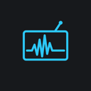
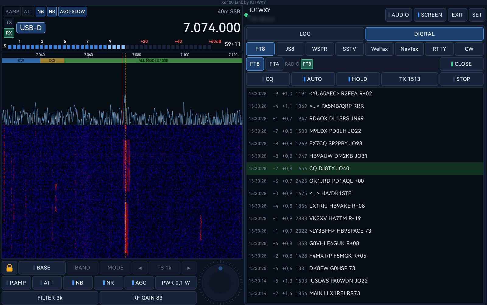
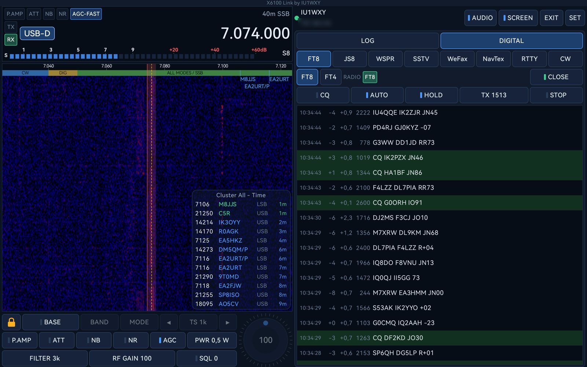
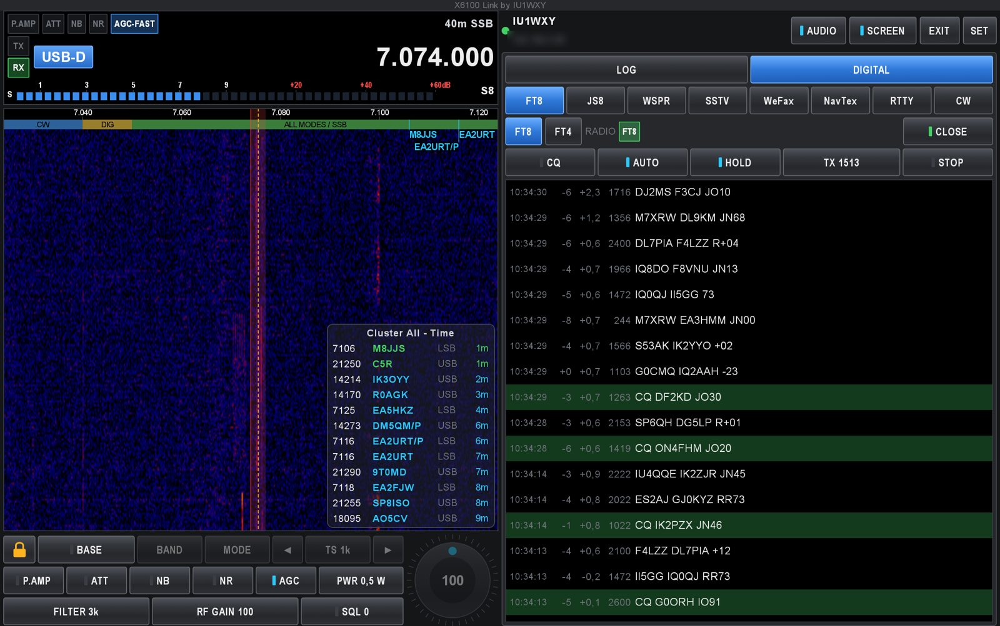
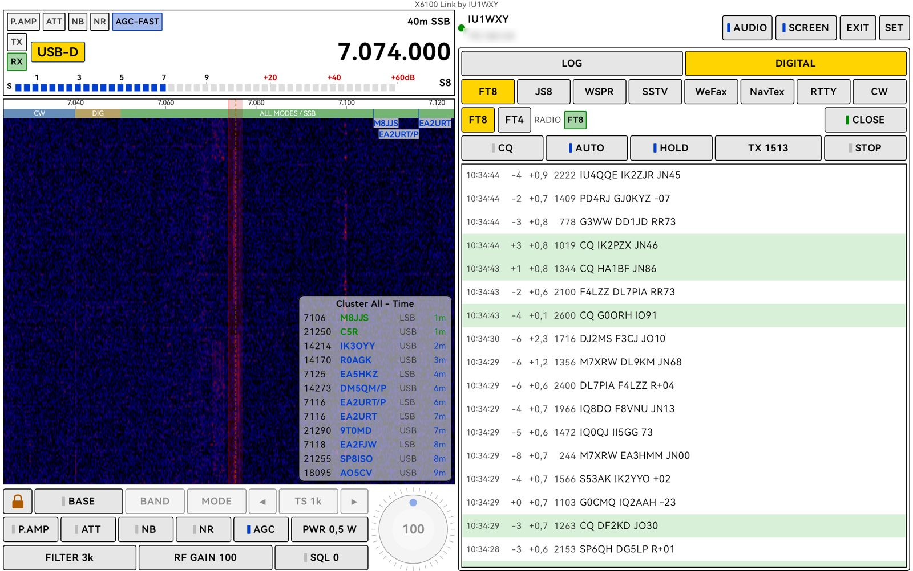
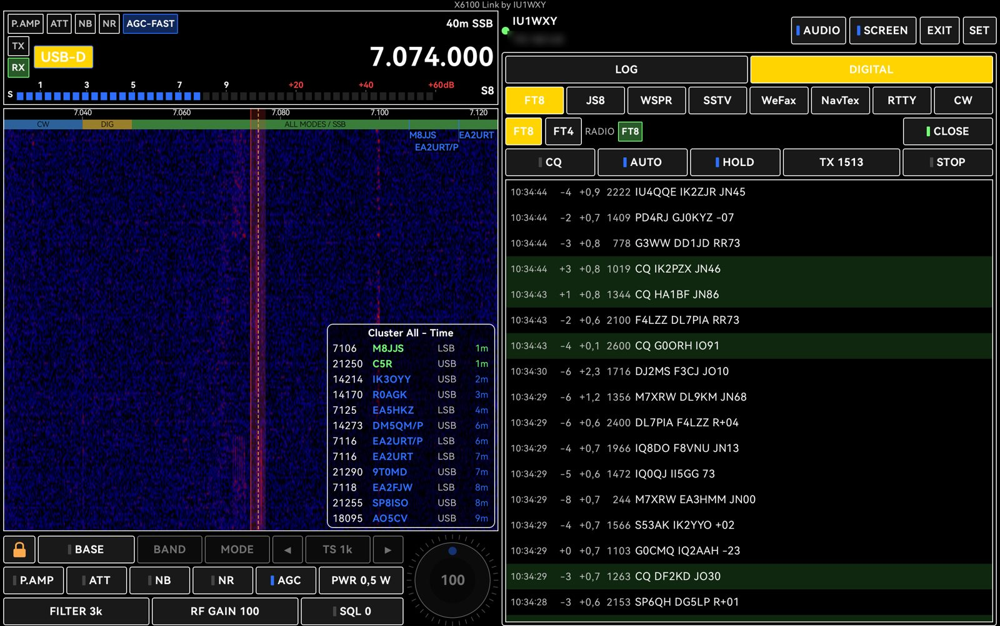

<h1 align="center">X6100 Link</h1>

<i>by Giovanni Ricciardi IU1WXY</i> · <a href="#italiano">Italiano</a>

<b>Your Xiegu X6100 on a phone or a tablet, over WiFi: the waterfall in your hand,
every digital mode with TX, a logger for every QSO.</b>

X6100 Link is the Android companion app of the **[X6100 IU1WXY firmware](https://x6100-link.it)**.
It works only with radios running that firmware, not with the stock Xiegu firmware.

**Coming soon on Google Play.** This repository holds the app's documentation, release notes and
bug reports; the app itself is distributed through Google Play.

## The radio in your hand

- Frequency, band, mode, tuning step and a VFO knob (bigger on tablets).
- Live **spectrum and waterfall** with frequency scale, IARU band plan, VFO line and filter passband:
  tap or drag to tune, pinch to zoom.
- S-meter, preamp, attenuator, NB, NR, AGC, squelch, filter width, RF gain and TX power.
- **RX audio on the phone**, with its own volume.
- The DX cluster as on the radio: calls over the waterfall and a column of spots around the VFO.

## Every digital mode, with TX

The radio decodes and transmits, the phone is the screen and the keyboard: **FT8 / FT4**, **JS8**,
**WSPR**, **SSTV** (pictures from the gallery or the camera), **WeFax**, **RTTY**, **CW** with macros,
**NavTex** (receive).

## A logger for every QSO

- Voice and CW QSOs in a few taps; FT8, FT4, JS8, Field Ops and the phone all write one ADIF log of
  the day on the radio.
- **QRZ.com lookup** as you type the call: name, QTH, locator, country, distance, photo.
- Filters by voice, CW or digital; edit or delete a QSO, add the other station's SOTA/POTA reference.

## SOTA and POTA

When the radio enters **Field Ops** the app switches by itself to its SOTA/POTA page: the reference and
the ones nearby, Start and End, QSO entry with the phone's keyboard, Spot. The phone's GPS gives the
radio its position.

## Themes

Classic, Pro, Outdoor and Outdoor-Negative for full sunlight. Phones and tablets, portrait and landscape.

<table>
  <tr>
    <td align="center"> <b>Pro</b></td>
    <td align="center"> <b>Classic</b></td>
  </tr>
  <tr>
    <td align="center"> <b>Outdoor</b></td>
    <td align="center"> <b>Outdoor-Negative</b></td>
  </tr>
</table>

## How to connect

1. Turn on the phone's hotspot (or use your home WiFi).
2. On the radio: Settings → Wireless, connect the radio to that network.
3. Open X6100 Link: it finds the radio by itself. Tap it, or type its IP.

App and firmware go together: keep both at the latest version.

## Problems and ideas

Open an **[issue](../../issues/new/choose)**: write the app and firmware versions, your phone or tablet
and what happens. Firmware problems go on the [website](https://x6100-link.it/report.php).

## Privacy

No account, no cloud, no tracking: the app talks only to your radio, and to QRZ.com if you enter your
login. Details in [PRIVACY.md](PRIVACY.md).

---

## Italiano

**X6100 Link** porta il tuo Xiegu X6100 sul telefono o sul tablet, via WiFi: il waterfall in mano, tutti
i modi digitali con la trasmissione, un logger per ogni QSO. È l'app compagna del
**[firmware X6100 IU1WXY](https://x6100-link.it/it.html)** e funziona solo con quel firmware.

**Presto su Google Play.** Questo repository contiene la documentazione dell'app, le note delle versioni
e le segnalazioni; l'app si scarica da Google Play.

- **La radio in mano**: frequenza, banda, modo, manopola VFO, spettro e waterfall, comandi, audio di
  ricezione sul telefono, DX cluster.
- **Tutti i modi digitali con la trasmissione**: FT8/FT4, JS8, WSPR, SSTV, WeFax, RTTY, CW con macro,
  NavTex in ricezione.
- **Un logger per ogni QSO**, con ricerca QRZ.com mentre scrivi il nominativo.
- **SOTA e POTA** con il Field Ops della radio; il GPS del telefono dà la posizione alla radio.
- **Quattro temi**, telefoni e tablet, verticale e orizzontale.

Problemi o idee: apri una **[issue](../../issues/new/choose)**. Privacy: [PRIVACY.md](PRIVACY.md).
Tutto il resto su **[x6100-link.it](https://x6100-link.it/link-it.html)**.
